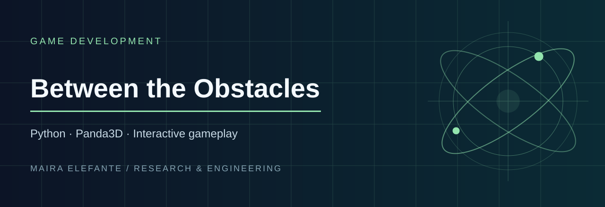

> **Python · Panda3D · Interactive gameplay**

**Focus:** Game Development · [Source and project files](./)

---

# Panda3D Platformer

A Python, Panda3D game project.

## Project files
This repository preserves the original project files.

## Running
The entry point is [`main.py`](main.py), which imports `Core.game_app.GameApp`. That `Core` package is not currently visible in the repository root, so a direct `python main.py` invocation may fail unless the missing module is supplied. The original project archive (`panda3d-platformer.zip`) is also included for reference.

## Notes
Review dependencies, assets and runtime compatibility before distribution.
